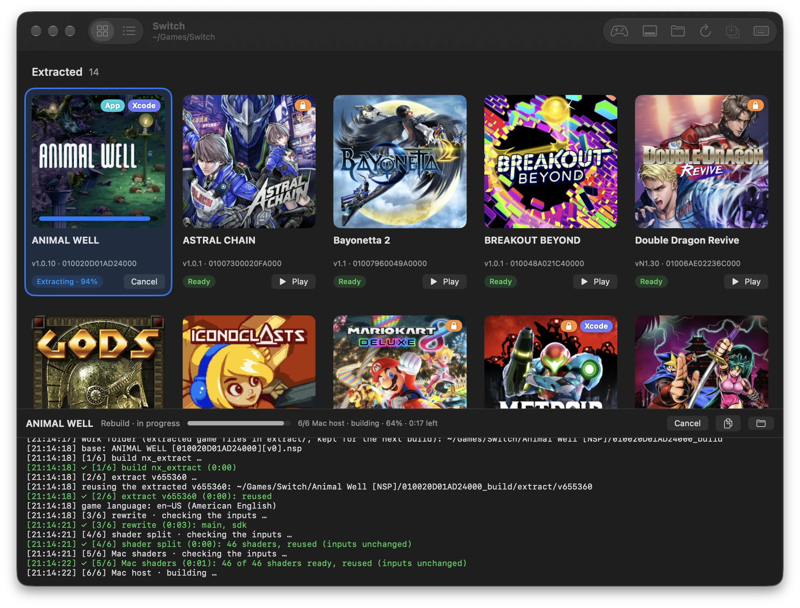
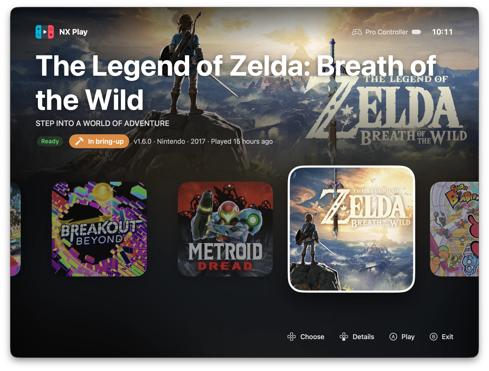
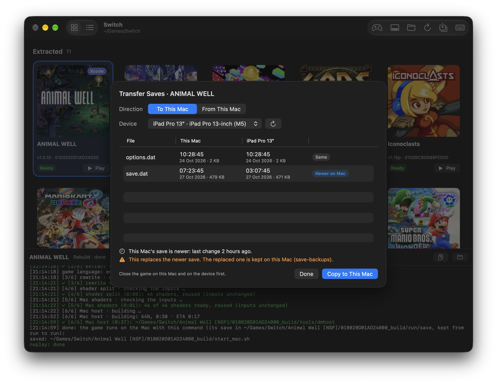

[nxnative](https://github.com/seedds/nxnative) does something I didn't think
I'd see: it takes a Switch game you own and rebuilds it to run natively on
Apple silicon, on the Mac or on an iPhone or iPad. It's a set of Python
scripts, though, and every game is its own command line, its own build folder
and its own save. Once I had more than two games, I wanted one window for all
of them.

That window is [NX Play](https://github.com/varyform/nx-native-wrapper).



## A folder per game

Point NX Play at a folder with one subfolder per game, holding your own NSP,
NSZ, XCI or XCZ files. Games that are built show their icons and a **Play**
button; the rest have **Extract**. Everything a game needs lives next to it:
the original files, the build, the saves and any IPA. Move the folder, or the
whole library, and it keeps working.

nxnative improves almost daily, so NX Play pulls its latest fixes before each
run and rebuilds a game when the code it was built with has changed. When a
game plays well, **Keep This Build** pins it, so an upstream change can't
break it.

## On the couch

Press Menu on a controller and the library turns into **Console Mode**: full
screen, the selected game's eShop banner across the top, your games in a row
below. The D-pad picks one, A plays it, and every connected controller becomes
a player of its own.



## The same save everywhere

**Install on Device** builds a game with Xcode, signed with your team, and
starts it on a connected iPhone or iPad. **Transfer Saves** then compares the
Mac's save with the device's, file by file, and shows which one is newer
before copying it over.



Two more things keep saves safe without thinking about them. With **Save
backup**, NX Play commits a game's save to your own private Git repository
each time the game saves, and pushes it. With **Cloud saves**, the Mac and
iPhone copies of a game play on from one save through iCloud Drive.

## The script underneath

Everything the app does goes through `nxplay`, a shell script you can also run
yourself:

```sh
./nxplay ~/Games/MetroidDread              # start it, building first if needed
./nxplay --ipa ~/Games/MetroidDread        # an unsigned IPA, to sideload
./nxplay --mac-app ~/Games/MetroidDread    # a standalone app for the Dock
```

The app is SwiftUI, and it looks after itself: Setup installs the tools it
needs with Homebrew and uv, and NX Play checks for a signed, notarized update
once a day and installs it when you quit.

## Try it

You need a Mac with Apple silicon, Xcode, Homebrew, and your own games and the
`prod.keys` of your own Switch. Nothing in NX Play downloads games or keys.
Grab the DMG from the
[latest release](https://github.com/varyform/nx-native-wrapper/releases/latest),
and the [README](https://github.com/varyform/nx-native-wrapper#readme) covers
the rest.
