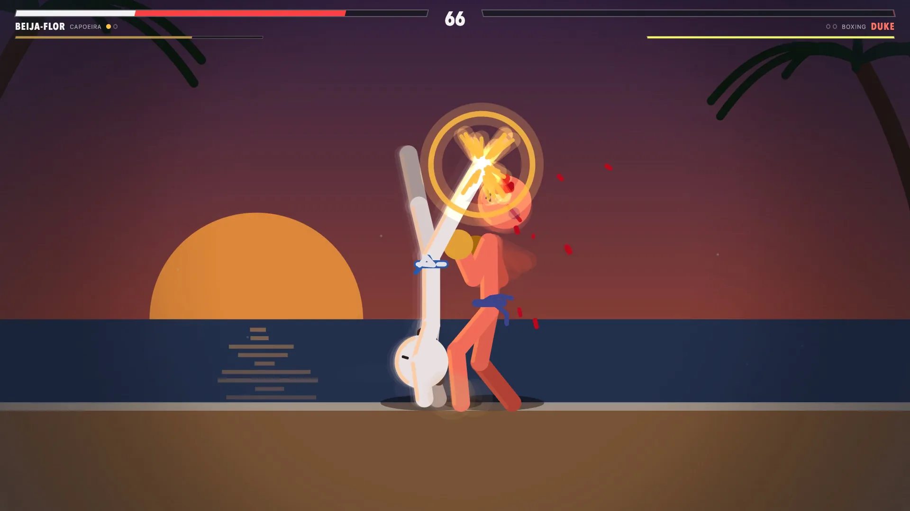
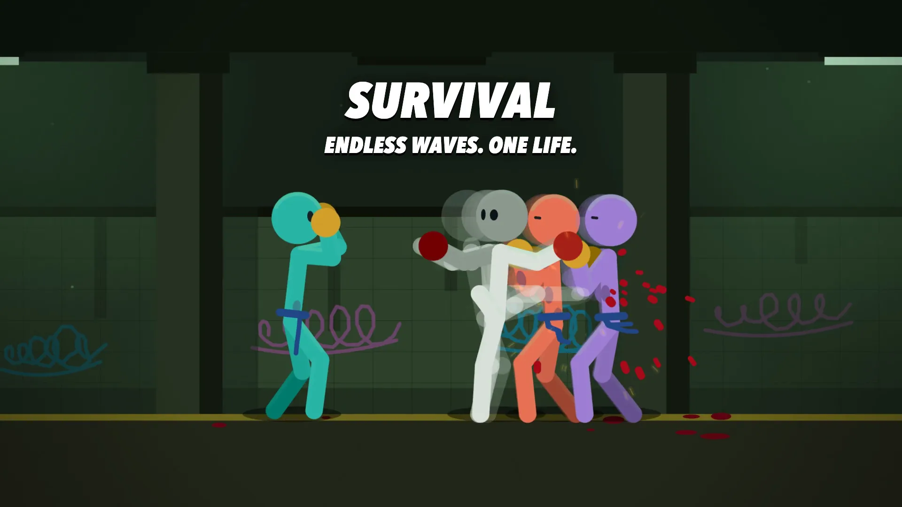
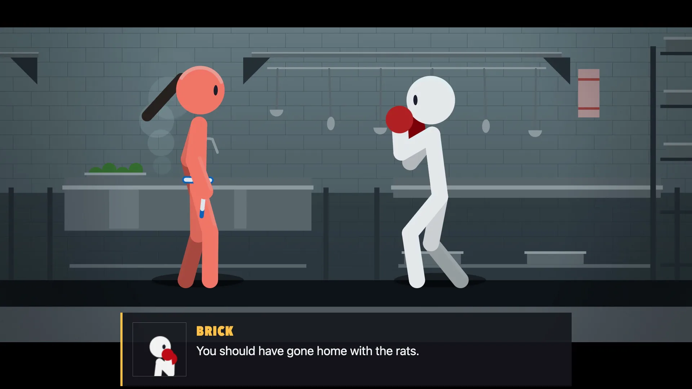

[Stickman's Fate](https://stickmans-fate.varyform.info) is a 2D fighting game
that runs in your browser, free, with nothing to install. There are six
fighting styles (Muay Thai, kickboxing, boxing, capoeira, karate and kung fu),
nine stages, a story with nine chapters and two endings, an endless Survival
mode, and online matches against a friend. It plays with a gamepad, a keyboard
or a touch screen.

The idea and the direction are mine. Claude Opus 5.5 wrote the code and drew
the graphics, and Suno V6 made the music.

## Stick figures with real joints

A fighter is a set of bones drawn as round-capped strokes on a Canvas 2D.
Animations aren't sprites or stored joint angles: a pose says where the hands,
feet and pelvis should go, and inverse kinematics works out the rest. That
solve runs inside the game's simulation, so hitboxes follow the same bones you
see on screen. A kick connects when the drawn foot gets there.

## The same fight, to the last bit

Online play uses rollback netcode over WebRTC. Players send each other only
their inputs, and each browser computes the fight for itself, so both have to
arrive at exactly the same numbers. They didn't: JavaScript engines don't agree
on the last digits of `Math.sin` and friends.

So the simulation now has its own sine, cosine, arctangent and the rest, built
only from operations that are exact everywhere: add, subtract, multiply, divide
and square root. A test fails if the built-in versions creep back in. Bot runs
then came out identical to the bit in Node on ARM and x86 and in JavaScriptCore.

## A leaderboard you can't type a score into

That same determinism makes scores checkable. When a Survival run starts, the
server picks its random seed. When it ends, the game sends back only the
player's inputs, and the server plays the whole run again with the game's own
code, about 2,400 times faster than real time. If the result doesn't match, the
score doesn't count.

This stops forged scores. It doesn't stop a bot that really plays well, because
that run really happened.

The boards are the top 10 of today, this week and this month, and the whole
thing is one SQLite file. Runs that fall off every board are removed right after
each night's backup, so the file stays small and the backups keep the history.

## Names with nothing to filter

Letting people type names means filtering them, in every language, and losing
anyway. So a name here is two words picked from fixed lists, like Angry Elbow or
Silent Noodle: about 20,000 combinations, none of them rude as far as I can
tell. It also works with a gamepad, where typing is miserable. The server checks
every name against the lists, so sending your own from the console gets you
nowhere.

## A trailer shot by the game

Because a fight replays exactly from its seed, the trailer isn't a screen
recording. It's a script: these fights, cut so their big hits land on the
music's beats, filmed frame by frame on a fake clock in headless Chrome. Change
the edit and it can be shot again, which takes about three minutes for the
minute-long film.

## Try it

[Play it here](https://stickmans-fate.varyform.info). On a phone, hold it
sideways. Pick a name on the Leaderboard screen, then see how long you last in
Survival.

Sound effects are by Daniel Barros (Sounds Good) and The Deadly Kombat Free
Library, and the announcer is VoiceBosch's Dragon fighting game announcer pack
from Pixabay.
